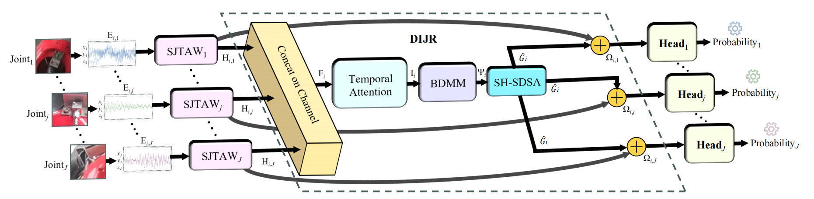
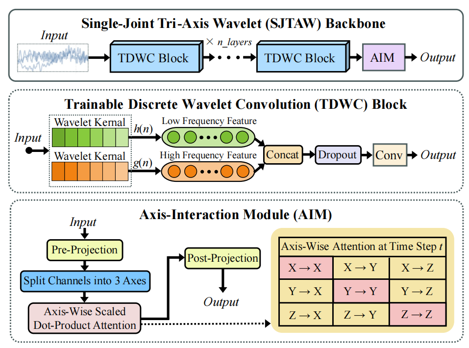
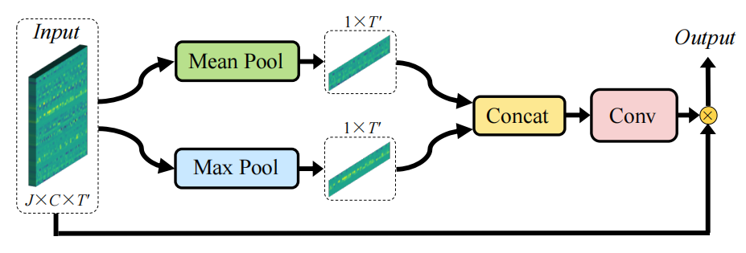

# JFDNet

**English** | [简体中文](README_CN.md)

Official PyTorch implementation of **JFDNet: A Robust Industrial Robot Multi-Joint Fault Detection Network Under Sensor Fault and Environmental Noise Scenarios**.

## Publication

| Publication | Details |
| --- | --- |
| Journal | IEEE Sensors Journal |
| DOI | [10.1109/JSEN.2026.3673312](https://doi.org/10.1109/JSEN.2026.3673312) |
| Date of Publication | 18 March 2026 |

## Overview

JFDNet performs robust per-joint fault detection from tri-axis vibration signals collected on six industrial robot joints. A dedicated Single-Joint Tri-Axis Wavelet (SJTAW) backbone preserves joint-private cues before the Dynamic Inter-Joint Relation neck models long-range dependencies across joints.



The SJTAW backbone combines Trainable Discrete Wavelet Convolution (TDWC) blocks with an Axis-Interaction Module (AIM).



The DIJR neck applies Temporal Attention before the Bi-Directional Mamba Mixer (BDMM).



## Repository contents

```text
JFDNet/
├── assets/
├── configs/
│   └── jfdnet.yaml
├── data/
│   └── dataset.py
├── experiments/
│   └── run_suite.py
├── models/
│   ├── ablations.py
│   ├── baselines.py
│   └── model.py
├── utils/
├── evaluate.py
└── train.py
```

`models/model.py` contains JFDNet and its paper-aligned modules: TDWC, AIM, SJTAW, Temporal Attention, BDMM, SH-SDSA, DIJR, and the untied joint heads.

## Data availability

The collaborating industrial partner has no plan to release the dataset. Therefore, this repository releases part of the core code and the experiment entry points, but does not include the proprietary data. Please refer to the paper for a detailed description of the dataset, collection setup, disturbance taxonomy, and split protocol.

## Environment

This project requires a Linux/CUDA environment with `mamba-ssm` support. The reported experiments used Ubuntu 22.04, Python 3.12, PyTorch 2.5.1, CUDA 12.4, mamba-ssm 2.2.2, and an NVIDIA RTX 4090.

## Baseline Comparison

| Model | Params | FLOPs (MFLOPs) | P/R/F1 (%) |
| --- | ---: | ---: | ---: |
| MJAR | 658.700K | 418.749 | 97.01/**99.43**/98.19 |
| CNN–LSTM | 190.182K | 290.661 | 97.08/97.59/97.32 |
| TICNN | 223.398K | 273.482 | 98.42/98.36/98.39 |
| MSMCNN | 86.150K | 287.048 | 92.00/93.44/92.55 |
| MLP | **582** | **1.152e-3** | 77.02/77.62/77.32 |
| CNN | 1.638K | 7.373 | 78.32/85.79/81.65 |
| LSTM | 28.614K | 137.626 | 67.26/91.47/76.47 |
| GRU | 183.942K | 790.414 | 81.30/88.75/84.85 |
| ResNet | 87.718K | 64.144 | 98.79/97.68/98.23 |
| **JFDNet (Ours)** | 13485.163K | 579.630 | **99.11**/98.79/**98.95** |

## Citation

If this work is helpful to your research, please consider citing:

```bibtex
@article{jiang2026jfdnet,
  title={JFDNet: a robust industrial robot multi-joint fault detection network under sensor fault and environmental noise scenarios},
  author={Jiang, Chengzhi and Huang, Yuhan and Hu, Xiaoxi and He, Yiming and Cao, Jingming and Wang, Naibang and Peng, Dandan},
  journal={IEEE Sensors Journal},
  year={2026},
  publisher={IEEE}
}
```
