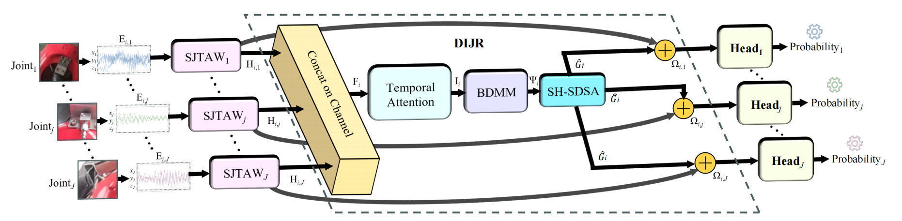
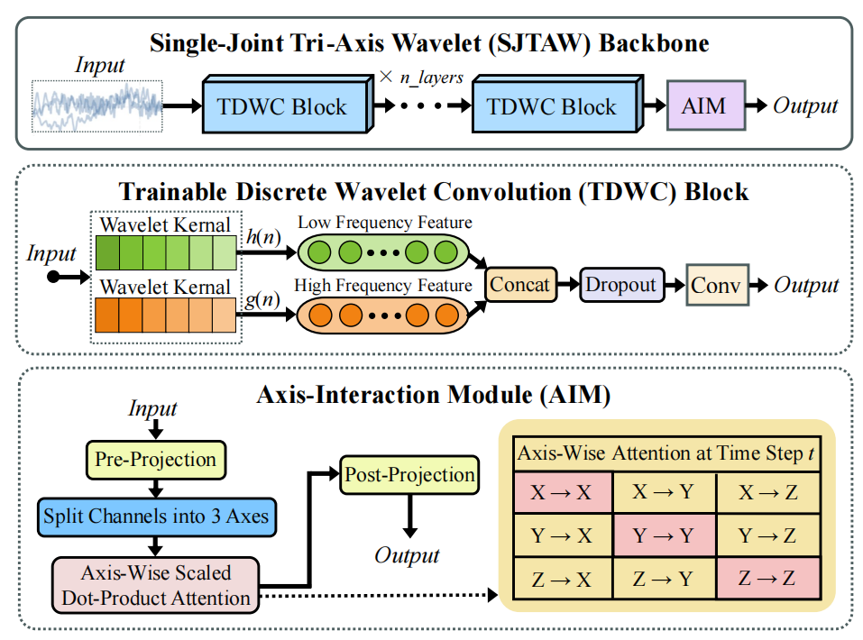
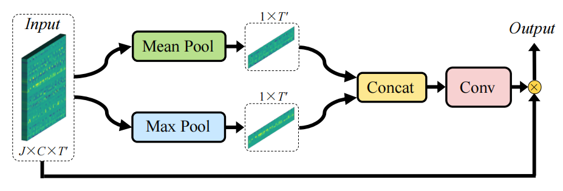

# JFDNet

[English](README.md) | **简体中文**

**JFDNet: A Robust Industrial Robot Multi-Joint Fault Detection Network Under Sensor Fault and Environmental Noise Scenarios**

## 论文信息

| Publication | Details |
| --- | --- |
| Journal | IEEE Sensors Journal |
| DOI | [10.1109/JSEN.2026.3673312](https://doi.org/10.1109/JSEN.2026.3673312) |
| Date of Publication | 18 March 2026 |

## 模型概述

JFDNet使用安装在工业机器人六个关节上的三轴振动信号，实现面向传感器故障与环境噪声场景的逐关节鲁棒故障检测。模型首先通过相互独立的 Single-Joint Tri-Axis Wavelet (SJTAW) 骨干保留各关节的私有故障特征，再由 Dynamic Inter-Joint Relation (DIJR) 颈部建模关节之间的长程依赖关系。



SJTAW 骨干由 Trainable Discrete Wavelet Convolution (TDWC) 模块和Axis-Interaction Module (AIM) 组成。



DIJR 在 Bi-Directional Mamba Mixer (BDMM) 之前使用Temporal Attention强调关键时间步。



## 项目结构

```text
JFDNet/
├── assets/
├── configs/
│   └── jfdnet.yaml
├── data/
│   └── dataset.py
├── experiments/
│   └── run_suite.py
├── models/
│   ├── ablations.py
│   ├── baselines.py
│   └── model.py
├── utils/
├── evaluate.py
└── train.py
```

`models/model.py` 包含JFDNet核心模块：TDWC、AIM、SJTAW、Temporal Attention、BDMM、SH-SDSA、DIJR和非共享逐关节分类头。

## 数据说明

由于合作厂商暂无开源数据集的计划，本仓库仅开放部分核心代码和全部实验入口，不提供受合作约束的原始数据。数据集、采集系统、干扰类型和划分协议的详细信息请参阅论文。

## 环境配置

本项目需要支持`mamba-ssm`的Linux/CUDA环境。论文实验使用Ubuntu 22.04、Python 3.12、PyTorch 2.5.1、CUDA 12.4、mamba-ssm 2.2.2和NVIDIA RTX 4090。

## 基线对比结果

| Model | Params | FLOPs (MFLOPs) | P/R/F1 (%) |
| --- | ---: | ---: | ---: |
| MJAR | 658.700K | 418.749 | 97.01/**99.43**/98.19 |
| CNN–LSTM | 190.182K | 290.661 | 97.08/97.59/97.32 |
| TICNN | 223.398K | 273.482 | 98.42/98.36/98.39 |
| MSMCNN | 86.150K | 287.048 | 92.00/93.44/92.55 |
| MLP | **582** | **1.152e-3** | 77.02/77.62/77.32 |
| CNN | 1.638K | 7.373 | 78.32/85.79/81.65 |
| LSTM | 28.614K | 137.626 | 67.26/91.47/76.47 |
| GRU | 183.942K | 790.414 | 81.30/88.75/84.85 |
| ResNet | 87.718K | 64.144 | 98.79/97.68/98.23 |
| **JFDNet (Ours)** | 13485.163K | 579.630 | **99.11**/98.79/**98.95** |

## 引用

如果本工作对您的研究有帮助，欢迎引用：

```bibtex
@article{jiang2026jfdnet,
  title={JFDNet: a robust industrial robot multi-joint fault detection network under sensor fault and environmental noise scenarios},
  author={Jiang, Chengzhi and Huang, Yuhan and Hu, Xiaoxi and He, Yiming and Cao, Jingming and Wang, Naibang and Peng, Dandan},
  journal={IEEE Sensors Journal},
  year={2026},
  publisher={IEEE}
}
```
